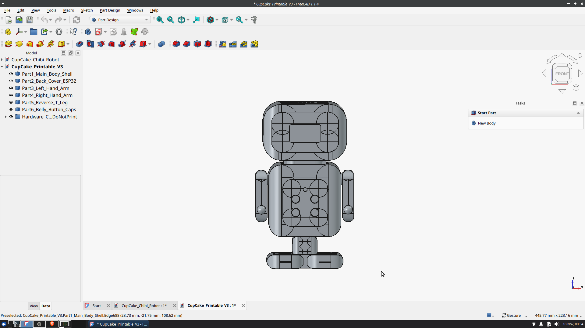

# CupCake Robot — FreeCAD parametric model



## Real Hardware Printable Model V4 (`cupcake_realhardware_v4.py`)

`cupcake_realhardware_v4.py` is the verified CAD revision tailored specifically for full-length hardware modules (ESP32-S3-DevKitC-1) and realistic rotational articulation in FreeCAD:

### What Was Solved in V4

1. **Continuous 74 mm × 30 mm Vertical Spine Channel:**
   - Real **ESP32-S3-DevKitC-1** is **69 mm long × 28 mm wide** (plus USB connector clearance).
   - The neck was widened to `42 mm` and the spine channel carved continuously from the middle of the head (Z=105 mm) down through the neck to the lower torso (Z=33 mm).
   - Single-piece removable rear cover (`Part2_Back_Cover_ESP32`) encloses the entire spine with bottom USB-C port access.

2. **Rotatable Hands & Leg with Local Servo Shaft Pivots:**
   - Both hands (`Part3_Left_Hand_Rotatable` & `Part4_Right_Hand_Rotatable`) are built around their local shoulder shaft origin `(0, 0, 0)`. Rotating `Placement.Rotation` around the **X-axis** swings the arms naturally.
   - The Reverse-T base (`Part5_Reverse_T_Leg_Rotatable`) is built with its local waist pivot at `X=0, Y=0`. Rotating `Placement.Rotation` around the **Z-axis** swivels the base left and right without colliding with the torso (2 mm gap).

3. **Hardware Clearance & Color Previews:**
   - Green Zone: Open front face window (`28 × 16 mm`) with internal `31 × 30 mm` OLED slide-in pocket.
   - Purple Zone: Head crown speaker pocket (`26 × 16 mm`) with 7 acoustic grille holes.
   - Sky Blue Zone: 4 tactile push-button through-holes + captive plunger pad (`Part6_Belly_Button_Caps`) + battery bay (`36 × 52 × 7.5 mm`).
   - Red Zone: Full-length ESP32-S3 preview board.

### Generating V4 Files

Run in FreeCAD console:
```bash
echo "exec(open('cupcake_realhardware_v4.py').read())" | freecad -c
```

Outputs:
- **FreeCAD Project:** `cad/CupCake_RealHardware_V4.FCStd`
- **STLs in `cad/out_v4/`:**
  - `Part1_Main_Body_Shell.stl`
  - `Part2_Back_Cover_ESP32.stl`
  - `Part3_Left_Hand_Rotatable.stl`
  - `Part4_Right_Hand_Rotatable.stl`
  - `Part5_Reverse_T_Leg_Rotatable.stl`
  - `Part6_Belly_Button_Caps.stl`

---

## Printable Robot Hardware V3 (`cupcake_printable_v3.py`)

`cupcake_printable_v3.py` is the latest bulletproof, 3D-printable model matched directly to the mobile phone companion mascot. It uses deterministic rounded-prism intersections (`chibi_pillow_box`) without fragile 3D edge fillets, and separates functional hardware zones cleanly.

### Hardware Zones & Fit

* **Green Zone (Open Screen Cutout & Internal PCB Slot):**
  - Open face window: `28 mm × 16 mm`
  - Internal slide-in slot: `31 mm × 30 mm` (4.5 mm depth) sized for standard 0.96" / 1.3" I2C SSD1306 OLED displays.
* **Purple Zone (Top Mini Speaker Bay & Acoustic Grille):**
  - Internal recessed pocket: `26 mm × 18 mm × 4.5 mm`
  - 7 through-hole acoustic grille vents on the head crown for mobile phone speakers or 20mm mini speakers.
* **Sky Blue Zone (Belly Push-Buttons & Battery Cradle):**
  - 4 physical tactile push-button through-holes + status pinhole on the belly.
  - Printable plunger pad (`Part6_Belly_Button_Caps`) captive behind the front wall.
  - Internal vertical torso battery retention rails (`38 mm` wide × `54 mm` tall × `8.5 mm` deep) for flat mobile Li-ion cells (e.g., BL-5C) or compact LiPo pouches.
* **Red Zone (Wide Spine Wire Channel + Removable Back Lid):**
  - Wide neck pass-through conduit for easy wiring between head and torso.
  - Removable rear service cover (`Part2_Back_Cover_ESP32`) with recessed cradle for ESP32-S3 boards (XIAO, SuperMini, DevKit) and bottom USB-C slot.
* **Movable Hands & Reverse-T Base:**
  - `Part3_Left_Hand_Arm` & `Part4_Right_Hand_Arm`: Rounded chibi capsule arms with thumb contours and shoulder servo horn bosses.
  - `Part5_Reverse_T_Leg`: Movable Reverse-T foot base with dual-foot lobes and bottom waist servo socket.

### Rebuilding & Exporting V3 (Headless or GUI)

Execute headlessly:
```bash
echo "exec(open('cupcake_printable_v3.py').read())" | freecad -c
```

Or open in FreeCAD GUI via **Macro $\rightarrow$ Macros... $\rightarrow$ Execute** `cupcake_printable_v3.py`.

Outputs land in `cad/out_v3/`:
- `Part1_Main_Body_Shell.stl`
- `Part2_Back_Cover_ESP32.stl`
- `Part3_Left_Hand_Arm.stl`
- `Part4_Right_Hand_Arm.stl`
- `Part5_Reverse_T_Leg.stl`
- `Part6_Belly_Button_Caps.stl`
- FreeCAD Document: `cad/CupCake_Printable_V3.FCStd`

---

## Legacy Walking Body Model (`companion_robot.py`)

## Rebuilding (headless)

```bash
freecadcmd cad/companion_robot.py
```

Outputs land in `cad/out/`:

| File                 | What it is                                             |
|----------------------|--------------------------------------------------------|
| `assembly.fcstd`     | Editable FreeCAD project (walking robot, 10 parts)     |
| `assembly.step`      | Export of every part for CAM/Cura/PrusaSlicer import    |
| `head_parts.step`    | `head_shell` (OLED window + horn hex) and `head_back`   |
| `torso_parts.step`   | `torso_shell` (2 shoulder + 2 hip + neck pockets) + lid |
| `arm_right/left`     | Mirrored arm paddles (in `assembly.step`)               |
| `hip_skirt_*`        | Hip rings with the 70 deg swing window (in `assembly`)  |
| `leg_right/left`     | Legs + foot pads + stop pins (in `assembly.step`)       |

Or open the generated `.fcstd` in the GUI, tweak parameters through the
script's `P` dict, and re-run the same file inside the FreeCAD Python console
(`exec(open('cad/companion_robot.py').read())`).

## Print settings

- 0.2 mm layers, 3 perimeters for servo pockets
- 15% gyroid infill for shells
- head_shell and head_back stand upright with no supports (face window is
  bridged by the bezel lip)
- arms print flat, boss down; legs + skirts print flat (skirts face down)
- base_plate is now OPTIONAL (desk mode) — the walking robot stands on its
  own two feet

## Hardware fit

| Pocket      | Meant for                                    |
|-------------|----------------------------------------------|
| Face window | SSD1306 0.96" OLED (128x64, I2C bus on GPIO8/9)|
| Torso side walls (x4, upper)  | Two shoulder servos, shafts through Low-side walls (z=30) |
| Torso side walls (x4, lower)  | Two hip servos, shafts through the walls (z=8.6)          |
| Head underside| Yaw servo horn (GPIO4, whole head twist)                    |
| Torso rear top pocket | Optional neck servo (GPIO13)                         |
| Torso cavity  | 503035 3.7 V Li cell + TP4056 + MT3608 5 V rail              |
| Lid cavity    | ESP32-S3 devkit standing, USB-C at the lid slot              |

4 servos total (1 yaw + 2 shoulders + 2 hips) + 1 optional neck.

**Servo pin map proposal for the walking body** (update `firmware/src/motor.h`
as part of wiring — current firmware drives a single shoulder pin):

| Servo        | Pin   | Motion                          |
|--------------|-------|---------------------------------|
| Yaw (head)   | GPIO4 | head twist (unchanged)          |
| Shoulder R   | GPIO5 | right arm paddle                |
| Shoulder L   | GPIO18| LEFT arm paddle — mirrored      |
| Hip R        | GPIO23| right leg swing                 |
| Hip L        | GPIO19| left leg swing                  |
| Neck (opt.)  | GPIO13| reserved                       |

Wiring keeps to firmware/README.md: battery ADC divider on GPIO2, wire
escape slots on `head_back` for the I2C + servo leads.


## Motion limits (mechanical, not firmware)

- **Arms:** two independent shoulder pivots -> firmware swings them in
  OPPOSITE phase for a walking gait (or together for a fan-wave). Recommended
  swing <= 25 deg per side so the arm paddle always clears the hip area.
- **Legs:** each hip skirt has a **70-degree open window** (35 deg each side
  of straight-down); the stop pin moulded into the leg plate rides in that
  window and hits the ring edges physically. Even buggy firmware cannot swing
  a leg past 70 deg total. `leg_swing` in the `P` dict tunes the window.
